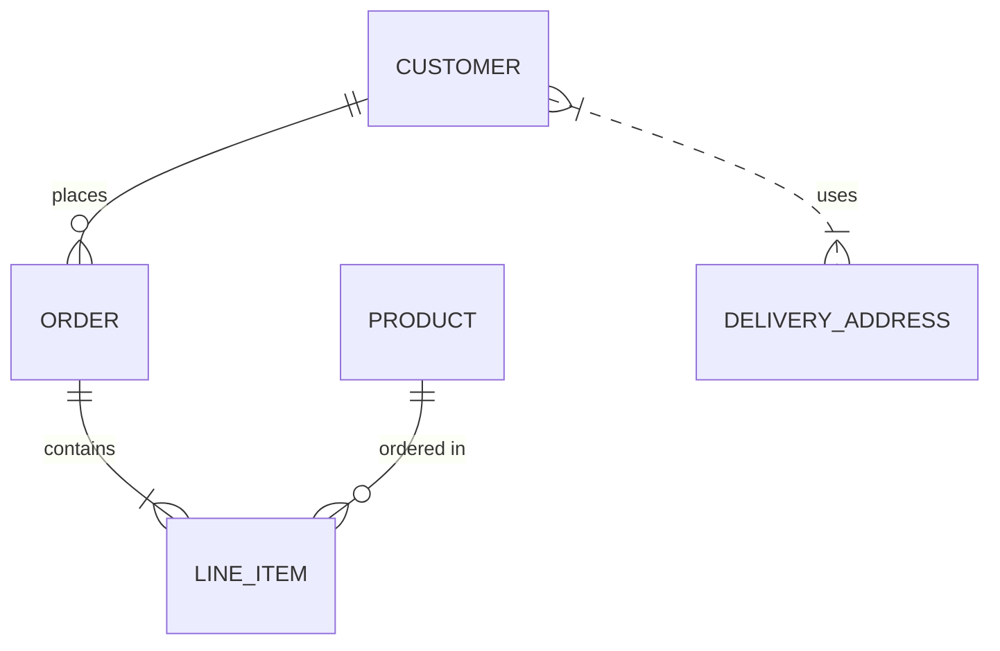
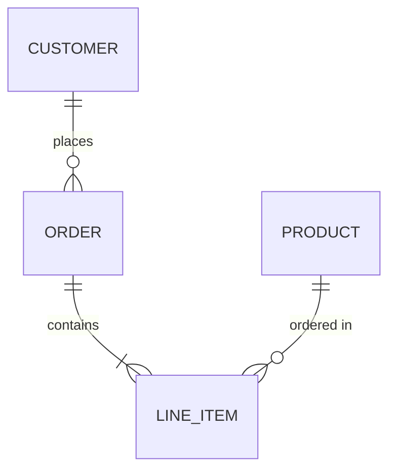
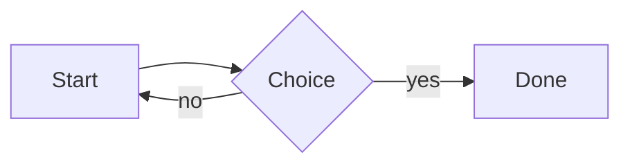

# Editor test bench

A document that exercises the editor's preview features, one section each.
The bench page has buttons for the ones only reachable through the API.

## Toolbar

- **Color scheme** (monitor, sun or moon icon): Light, Dark or System. System
  follows the operating system's setting live. Switching keeps the preview in
  place: nothing moves, and the diagrams below are redrawn in the new colors.
- **Page width** (page icon, between zoom and color scheme): Narrow, Default,
  Wide or Full Width, labeled with the pixel width each gives at the current
  zoom. Hidden in edit layout.

## Task lists

- [x] Completed task (checked, greyed: the preview is read-only)
- [ ] Open task
- [ ] Parent task
  - [x] Completed subtask
  - [ ] Open subtask
- A plain bullet in the same list (keeps its bullet)

## Horizontal rules

Three styles below should show as three separate thin lines:

***

---

___

## Footnotes

Here is a statement with a footnote.[^1] And another one.[^note] The first again.[^1]

This reference has no definition, so it stays as text: [^missing].

Click a superscript number to jump down, then the ↩ to come back.

[^1]: The first footnote.
[^note]: A named footnote with **formatting** and a [link](https://mdzip.org).

## Copying

Right-click the preview. With text selected, **Copy** offers Plain Text,
Formatted Text and HTML; **Copy All** offers the same for the whole document,
plus Markdown. Each item has a hover tip. **Select All** (Ctrl+A) selects the
rendered document; Ctrl+C then copies all of it as Formatted Text. Ctrl+C on any
other selection copies just that, as Formatted Text.

Paste into Notepad and Word to compare. Formatted Text embeds the image below,
so it shows in Word; HTML keeps its path, `images/sample.png`. Neither has a
`blob:` URL, and plain text never includes a diagram's stylesheet.


```js
// Code block: its header (language, Copy button) is never copied.
const answer = 42;
```

## Diagrams

On Mermaid 12, ER diagrams and flowcharts use the ELK layout: right-angle lines.



This one declares `layout: dagre` itself, so it keeps curved lines:





## Deep link into another file

[Chapter, deep section](docs/chapter.md#deep-section) opens the chapter and
lands on its "Deep section" heading. The bench's **openPath** button does the
same through the API.
