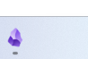
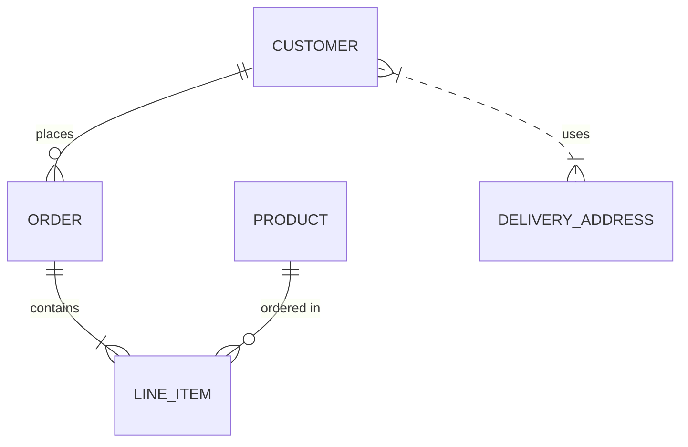
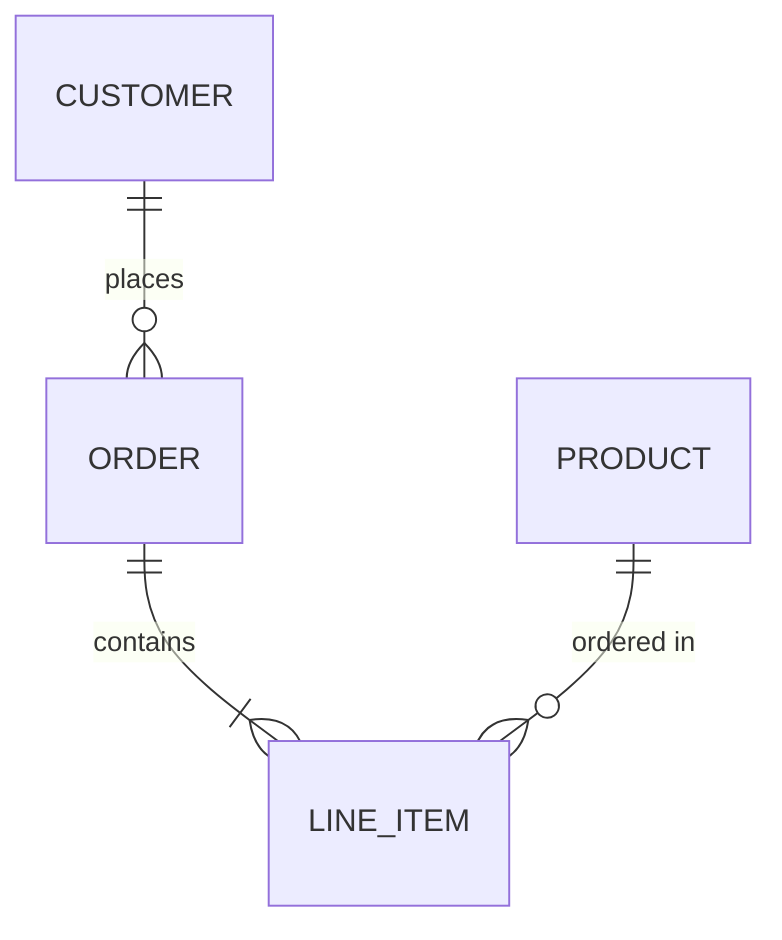
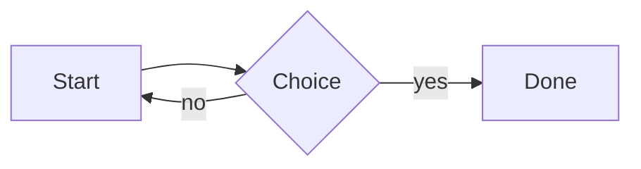
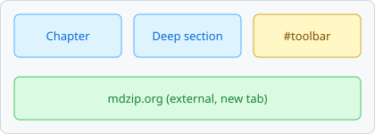

# Editor test bench

A document that exercises the editor's preview features, one section each.
The bench page has buttons for the ones only reachable through the API.

## Toolbar

- **Color scheme** (monitor, sun or moon icon): Light, Dark or System. System
  follows the operating system's setting live. Switching keeps the preview in
  place: nothing moves, and the diagrams below are redrawn in the new colors.
  Tick **System follows a host theme** on the bench: System becomes "Host
  theme" with a palette icon and follows the dark/light list beside it, as
  it follows the VS Code theme in the extension.
- **Page width** (page icon, between zoom and color scheme): Narrow, Default,
  Wide or Full Width, labeled with the pixel width each gives at the current
  zoom. Hidden in edit layout.
- **Outline** (table-of-contents icon): each click goes to the next of outline
  on the left, on the right, hidden. The icon shows the side the outline is on
  (a page with a column on that side); the tooltip says what the next click
  does. The panel slides out, the document glides over, and the panel slides
  in on its new side; with the system's reduced motion on, it's instant.
  Clicking quickly several times ends on the right state. The log shows
  `onOutlinePositionChanged` and `onOutlineVisibilityChanged`.

## Task lists

- [x] Completed task (checked, greyed: the preview is read-only)
- [ ] Open task
- [ ] Parent task
  - [x] Completed subtask
  - [ ] Open subtask
- A plain bullet in the same list (keeps its bullet)

## Horizontal rules

Three styles below should show as three separate thin lines:

***

---

___

## Footnotes

Here is a statement with a footnote.[^1] And another one.[^note] The first again.[^1]

This reference has no definition, so it stays as text: [^missing].

Click a superscript number to jump down, then the ↩ to come back.

[^1]: The first footnote.
[^note]: A named footnote with **formatting** and a [link](https://mdzip.org).

## Copying

Right-click the preview. With text selected, **Copy** offers Plain Text,
Formatted Text and HTML; **Copy All** offers the same for the whole document,
plus Markdown. Each item has a hover tip. **Select All** (Ctrl+A) selects the
rendered document; Ctrl+C then copies all of it as Formatted Text. Ctrl+C on any
other selection copies just that, as Formatted Text.

Paste into Notepad and Word to compare. Formatted Text embeds the image below,
so it shows in Word; HTML keeps its path, `images/sample.png`. Neither has a
`blob:` URL, and plain text never includes a diagram's stylesheet.



```js
// Code block: its header (language, Copy button) is never copied.
const answer = 42;
```

## Diagrams

On Mermaid 12, ER diagrams and flowcharts use the ELK layout: right-angle lines.



This one declares `layout: dagre` itself, so it keeps curved lines:





## Links in SVG diagrams

An SVG with links is shown inline, so its links can be clicked (an SVG image is
a flat picture). Click each box: **Chapter** opens `docs/chapter.md`, **Deep
section** opens it at that heading, **#toolbar** scrolls to the Toolbar section,
and **mdzip.org** opens the website in a new tab. Each click is in the log. The
diagram should sit on the right with this text beside it, like any
`align="right"` image.



For the full set (draw.io's real Project diagram, an SVG without links and a
hostile SVG that must never show an alert), choose
`TestFiles/svg-links-test.mdz` with **Choose File**.

## draw.io diagrams

The preview can't draw a raw `.drawio` file yet, so an image pointing at one
shows a card instead of a broken image: the diagram's alt text, its path, why
it isn't drawn and how to show it (save it as a `.drawio.svg`). The bench's
host file action appears on the card as a **Log This File (bench)** button;
clicking it logs `diagrams/flow.drawio`. Under it, the card says the same
action is on the file's right-click menu in the contents pane. Copying this section as HTML gives an
`` again, without the card's text.


## Empty table rows

The blank rows of a form or revision log are a full line tall, as in Word,
not thin strips. Copying the table doesn't copy anything into the empty cells.

| Version | Date | Change |
|---|---|---|
| 1.0 | 2026-11-01 | First issue |
| | | |
| | | |

## Files the preview can't show

Open `files/sample.zip` in the contents pane. Instead of "Binary file preview
unavailable" it shows a card: the file's name, "ZIP archive" and its path, then
the bench's **Log This File (bench)** button, **Extract…** (or **Download**)
and **Replace…**, each with a line saying what it does.

## Deep link into another file

[Chapter, deep section](docs/chapter.md#deep-section) opens the chapter and
lands on its "Deep section" heading, with a little space above it. The bench's
**openPath** button does the same through the API.
